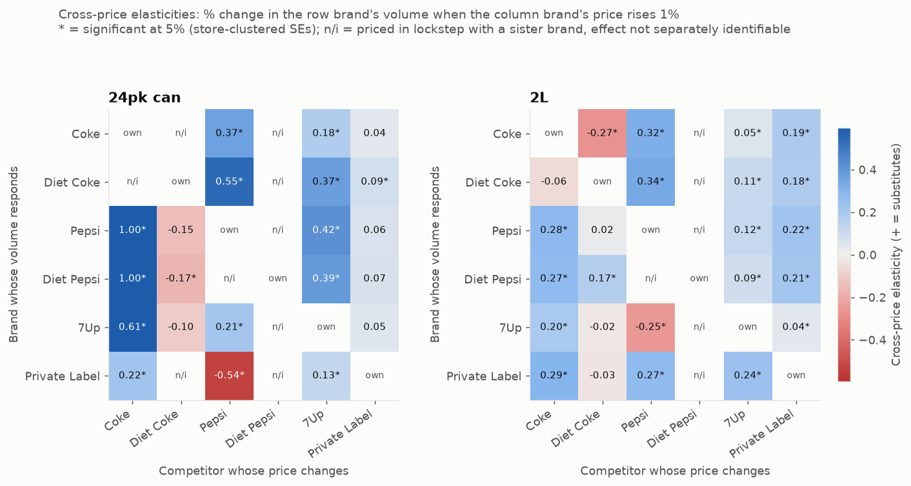
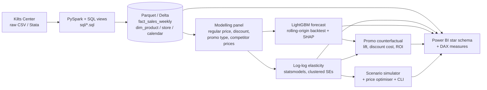
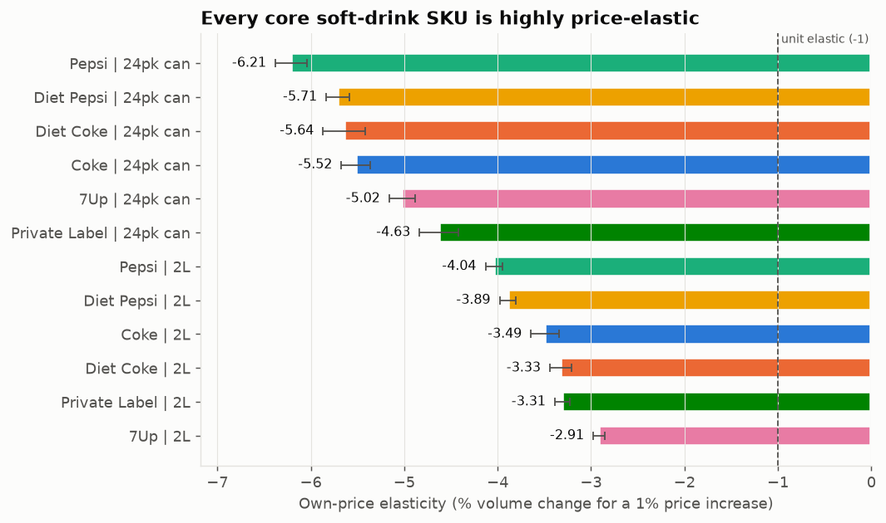
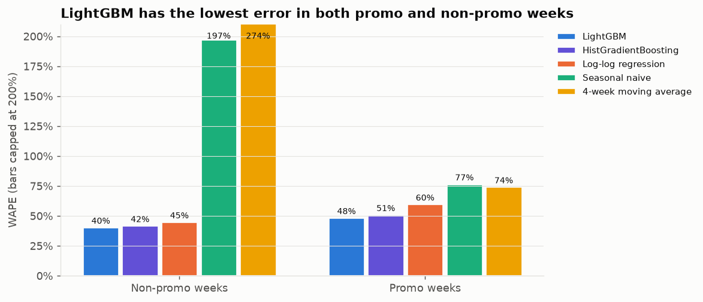
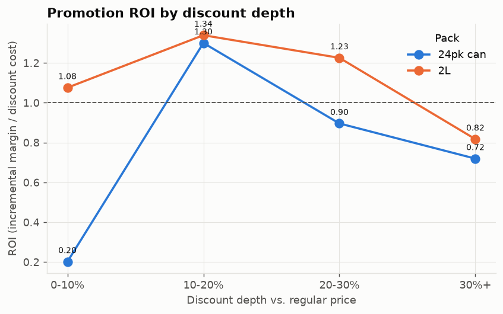
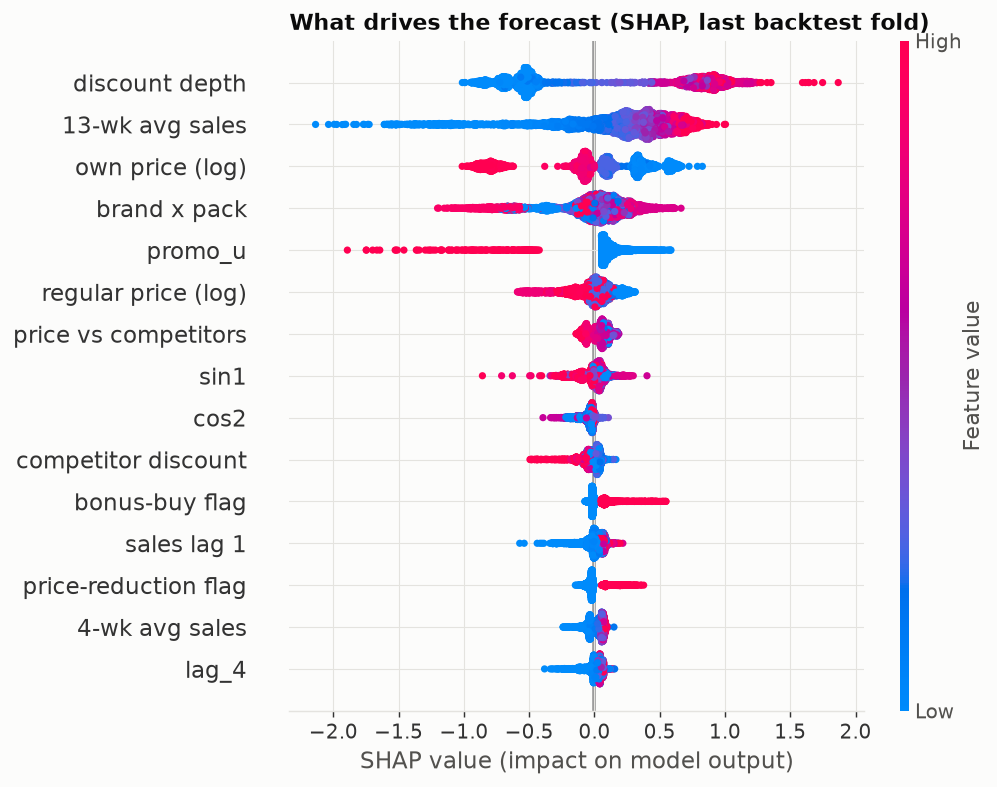
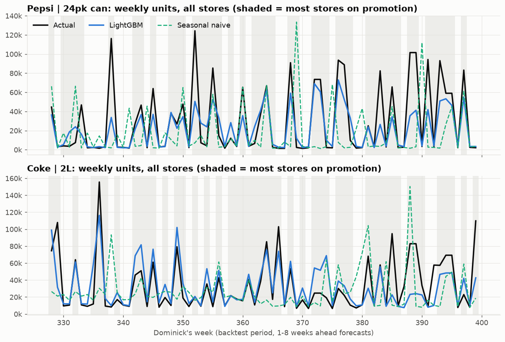
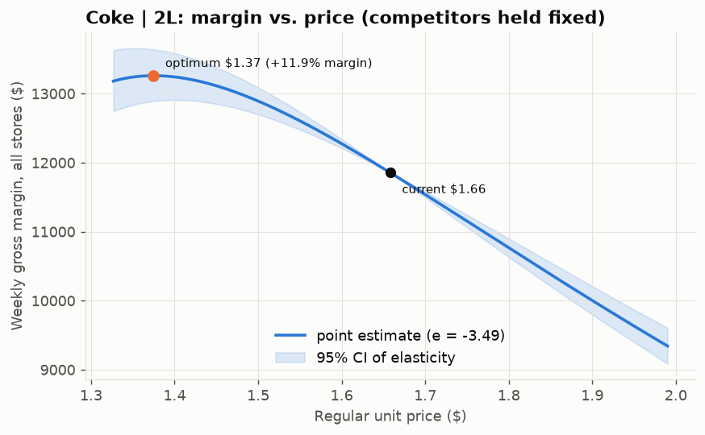

# Beverage Demand Forecasting, Price Elasticity & Promotion Analytics

[](https://github.com/smil7/beverage-demand-elasticity/actions/workflows/ci.yml)
 

**How price-sensitive are soft-drink shoppers, which promotions actually pay back, and how well can
we forecast store-level demand?** An end-to-end analysis of 17.7M weekly scanner records from 93
Chicago supermarkets (Dominick's, 1989-1997), built the way a beverage revenue-management team works:
SQL/PySpark data model -> econometric elasticities -> ML forecasting -> promotion ROI -> scenario
planning -> Power BI.



## Business problem

A bottler's commercial team spends a large share of revenue on price promotions and trade deals
with retailers. To plan that spend they need to know (1) how much volume moves when a price
changes -- for their own brand and for competitors, (2) which promotion mechanics and discount
depths generate margin rather than just volume, and (3) a forecast of weekly demand that
understands the promotion calendar, so supply and sales plans line up. This project answers all
three on real retail data and packages the answers as tools a sales or pricing manager can use.

## Key results

All numbers are generated by the pipeline into [`results/summary.json`](results/summary.json).

| | Result |
|---|---|
| **Data processed** | 17.7M raw store x UPC x week rows -> 10.7M clean -> 2.39M brand x pack x store x week rows; 93 stores; 390 weeks (Sep 1989 - May 1997) |
| **Modelled** | 12 brand-pack series (6 brands x 2L / 24-pack cans), 1,026 store-series, 381k store-weeks |
| **Own-price elasticity** | -2.9 to -6.2 (median -4.3); all negative with tight 95% CIs. Most elastic: **Pepsi 24-pack (-6.2)**; least: **7Up 2L (-2.9)**. 24-packs (median -5.6) are far more price-sensitive than 2L (median -3.4) |
| **Cross-price elasticity** | 80% of identifiable pairs positive (substitutes), 69% significant; 15 of 60 pairs flagged *not identified* because sister brands are priced in lockstep |
| **Forecast accuracy** (store x week, 1-8 weeks ahead, 9-fold rolling-origin backtest) | LightGBM WAPE **0.475** vs seasonal naive 0.908 -> **48% lower error**; vs best baseline (log-log regression, 0.580) -> **18% lower** |
| **... at chain level** (summed over stores) | LightGBM WAPE 0.426 vs seasonal naive 0.881 and regression 0.519 |
| **... in promo weeks** | LightGBM WAPE **0.485** vs seasonal naive 0.766 (**37% lower**) and regression 0.598 (19% lower) |
| **Promotion lift** | Promo weeks sell **6.6x** the no-promo baseline on average (24-pack 16.5x, 2L 4.8x); 39,378 promoted store-weeks, 15,523 events, out-of-sample |
| **Promotion ROI** | Overall **0.89** (incremental margin / discount cost). **10-20% discounts pay back (ROI 1.30-1.34); 30%+ discounts don't (0.72-0.82)** but take 66% of discount spend. 28% of ranked promotion types have ROI > 1. Biggest margin winner: Pepsi 24-pack, simple price reduction 10-20% off (ROI 2.02, +$0.97M) |
| **Price optimisation** (example) | Coke 2L: margin-maximising regular price $1.37 vs $1.66 today -> **+11.9% gross margin** (with -3.49 elasticity; assumes constant elasticity, no competitor reaction -- directional only) |

## Recommendations

1. **Re-balance trade spend from deep to moderate discounts.** 30%+ deals destroy margin (ROI
   0.72-0.82) yet absorb two-thirds of the discount budget; 10-20% deals return $1.30-1.34 per $1.
   Test shallower depths in a subset of stores before rolling out.
2. **Always pair price cuts with merchandising.** Untagged price cuts have the weakest ROI (0.47-0.55)
   versus 0.86-0.94 for bonus-buy and sale-tagged promotions.
3. **Give demand planning the promotion calendar.** The planned discount is the #1 forecast
   driver; using it cuts store-level forecast error by 37% in promo weeks vs. naive methods, and
   the summer holidays (July 4th +37%, Labor Day +32%, Memorial Day +27%) need their own plans.

The full stakeholder write-up is in [`reports/executive_summary.md`](reports/executive_summary.md).

## Approach



| Phase | Where | Highlights |
|---|---|---|
| 1. Ingestion & data model | `src/beverage_demand/ingest`, `sql/`, [`results/data_quality_report.md`](results/data_quality_report.md) | PySpark pipeline running SQL views; auditable brand mapping in [`config/brand_mapping.csv`](config/brand_mapping.csv); codebook calendar with holidays; DQ checks |
| 2. EDA | [`notebooks/01_eda.ipynb`](notebooks/01_eda.ipynb) | Trends, seasonality, promo frequency/depth, price-volume; every chart has a "so what" |
| 3. Elasticity | `src/beverage_demand/elasticity`, [`notebooks/02_elasticity.ipynb`](notebooks/02_elasticity.ipynb) | Own + cross elasticities, promo/post-promo effects, pooled & price-tier robustness, endogeneity discussion |
| 4. Forecasting | `src/beverage_demand/forecasting`, [`notebooks/03_forecasting.ipynb`](notebooks/03_forecasting.ipynb) | Direct multi-horizon global LightGBM, 3 baselines, 9-fold rolling origin, promo/non-promo split, SHAP |
| 5. Promotions | `src/beverage_demand/promo`, [`notebooks/04_promo.ipynb`](notebooks/04_promo.ipynb), [`results/promo_ranking.md`](results/promo_ranking.md) | Counterfactual baseline, lift, discount investment, ROI, post-promo dip, cannibalisation |
| 6. Scenarios | `src/beverage_demand/scenario`, [`notebooks/05_scenarios.ipynb`](notebooks/05_scenarios.ipynb) | `simulate()` with cross-brand effects + uncertainty; scipy price optimiser; CLI |
| 7. Databricks & Power BI | [`databricks/`](databricks/README.md), [`powerbi/`](powerbi/DASHBOARD_SPEC.md) | Source notebooks writing Delta tables; star-schema export, [`measures.dax`](powerbi/measures.dax), 5-page dashboard spec |
| 8. Communication | [`reports/`](reports/executive_summary.md), [`docs/methodology.md`](docs/methodology.md), [`docs/interview_prep.md`](docs/interview_prep.md) | Exec summary for a VP Sales; methodology for reviewers |

<details>
<summary><b>More charts</b></summary>

| | |
|---|---|
|  |  |
|  |  |
|  |  |

</details>

### Scenario CLI

```bash
uv run scenario --brand "Coke" --pack 2L --price-change -10 --weeks 4
```

```
Scenario: Coke | 2L regular price $1.66 -> $1.49
Assumes constant elasticities and no competitor price reaction; ranges from elasticity standard errors.
            Series       Role Units (base) Units (scenario) Units 90% range Volume Revenue Gross margin GM $ change
         Coke | 2L     target       70,004          101,153  99,823-102,475 +44.5%  +30.0%        +9.1%      +4,322
          7Up | 2L competitor       17,896           17,530   17,435-17,619  -2.0%   -2.0%        -2.0%        -184
    Diet Coke | 2L competitor       59,363           59,740   59,269-60,172  +0.6%   +0.6%        +0.6%        +256
   Diet Pepsi | 2L competitor       29,640           28,816   28,655-28,977  -2.8%   -2.8%        -2.8%        -320
        Pepsi | 2L competitor       46,037           44,703   44,472-44,951  -2.9%   -2.9%        -2.9%        -555
Private Label | 2L competitor       94,016           91,156   90,515-91,796  -3.0%   -3.0%        -3.0%      -1,479
```

## How to run

Requires Python 3.11-3.12 (managed by [uv](https://docs.astral.sh/uv/)) and Java 17+ for PySpark.

```bash
uv sync                                    # create the environment from uv.lock
uv run python scripts/download_data.py     # Dominick's soft-drink files -> data/raw (see data/README.md)
make all                                   # or: uv run bev all   (data -> elasticity -> forecast -> promo -> scenario -> powerbi -> summary)
make test                                  # unit tests on synthetic data (also run in CI)
```

Individual steps: `make data | features | elasticity | forecast | promo | scenario | powerbi | summary | notebooks`.
A full run from raw data takes about 10 minutes on a laptop (the backtest is ~3 minutes).
On Windows without Hadoop's `winutils`, the Spark step collects through Arrow and writes Parquet with
pyarrow; on Linux/Databricks it uses Spark's writer.

- **Databricks:** see [`databricks/README.md`](databricks/README.md) (Free Edition, Volume upload, Delta tables).
- **Power BI:** `make powerbi`, then follow [`powerbi/DASHBOARD_SPEC.md`](powerbi/DASHBOARD_SPEC.md).

**Data licence:** the Dominick's data are provided by the Kilts Center for Marketing, University of
Chicago Booth School of Business, for academic research use. No raw or processed data are committed;
`results/` holds only aggregated model outputs. Acknowledgement: *Dominick's Finer Foods data
courtesy of the James M. Kilts Center for Marketing, University of Chicago Booth School of Business.*

### Dashboard

Screenshots of the Power BI dashboard built from the spec go here (`docs/images/dashboard_1_overview.png`
... `dashboard_5_scenario.png`; see [`docs/images/README.md`](docs/images/README.md)).

<!-- After building the dashboard, uncomment:
| Executive overview | Price & elasticity | Promotion performance |
|---|---|---|
|  |  |  |
| **Forecast accuracy** | **Scenario planner** | |
|  |  | |
-->

## Limitations & next steps

- **Endogeneity:** prices are set by the retailer, often in high-demand weeks; and almost all price
  variation is temporary deals, which overstate the response to permanent price changes. The
  elasticities are best read as upper bounds -- see [`docs/methodology.md`](docs/methodology.md#endogeneity----the-honest-caveat).
  Next: cost-based or Hausman instruments, or a store experiment.
- **One retailer, 1990s data:** the methods transfer; the numbers should be re-estimated on current data.
- **Retailer, not bottler, economics:** ROI is category gross margin; traffic/basket effects and
  bottler trade terms are not included.
- **No competitor reaction** in scenarios/optimisation; constant elasticities.
- **Lockstep pricing** of sister brands (Pepsi/Diet Pepsi, Coke/Diet Coke 24-packs) makes some
  cross-elasticities unidentifiable -- reported as such.
- **Databricks notebooks** were written but not executed on a Databricks workspace by the author.
- Stretch goals not done: hierarchical forecast reconciliation, Bayesian hierarchical elasticities,
  promo-calendar optimisation under a budget, Streamlit planner, MLflow tracking.

## Tech stack

Python · SQL · PySpark · Databricks (Delta, Unity Catalog Volumes) · pandas · statsmodels ·
LightGBM · scikit-learn · SHAP · SciPy · DuckDB (exploration) · matplotlib · Power BI (DAX) ·
uv · ruff · pytest · GitHub Actions

## Repository layout

```
config/            settings.yaml, brand_mapping.csv
sql/               business views: movement_clean, dim_product, dim_store, dim_calendar, fact_sales_weekly, fact_brand_week
src/beverage_demand/
  ingest/          PySpark pipeline, product/calendar/store dims, data-quality checks
  features/        modelling panel (regular price, discount, promo type, competitor prices)
  elasticity/      log-log model + runner
  forecasting/     leakage-safe features, backtest, metrics, charts/SHAP
  promo/           lift, ROI, ranking
  scenario/        simulator, optimiser
  viz/             shared chart style, EDA charts
  cli.py           `bev` and `scenario` commands
notebooks/         01_eda ... 05_scenarios (narrative; logic lives in src/)
databricks/        Databricks source notebooks + README
powerbi/           measures.dax, DASHBOARD_SPEC.md (export written to powerbi/export/, git-ignored)
results/           summary.json, CSV outputs, figures (aggregated only)
reports/           executive_summary.md
docs/              methodology.md, interview_prep.md, images/
tests/             synthetic-data tests (elasticity recovery, leakage, promo ROI arithmetic, mapping)
```
