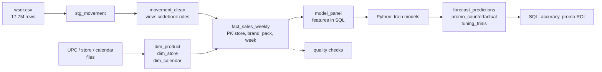
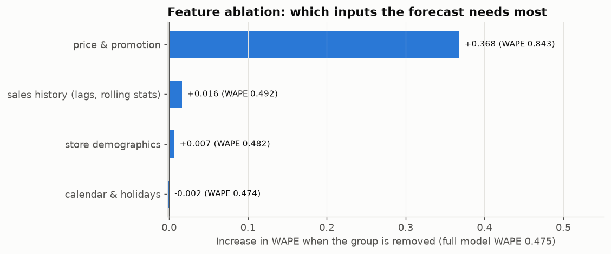

# Beverage Demand Forecasting & Promotion Analytics

[](https://github.com/smil7/beverage-demand-elasticity/actions/workflows/ci.yml)
  

I took 17.7 million rows of real supermarket scanner data (soft drinks, 93 Chicago stores,
1989-1997), built a **SQL data warehouse** for it, and **trained and evaluated forecasting models**
that predict weekly demand per product and store -- then used them to answer business questions:
how price-sensitive shoppers are, and which promotions actually pay back.


## What this project shows

**1. Databases & SQL**
- A DuckDB warehouse with layers: raw staging (17.7M rows) -> cleaning view -> **star schema**
  with primary keys -> feature table -> model-output tables (`sql/`).
- **Feature engineering written in SQL**: window functions (`LAG`, rolling `MAX`,
  `LAST_VALUE ... IGNORE NULLS` forward-fill), `PIVOT`, and a gaps-and-islands query for promotion
  events. I verified the SQL against an independent pandas implementation: all 381,397 rows match.
- **Data-quality checks as SQL** that block bad loads; they caught 9 missing weeks, 7 stores with no
  demographics and 1.2% of rows with impossible margins.
- Model outputs (predictions, tuning trials, experiment runs) go **back into the database**, and
  accuracy and promotion ROI are computed with SQL queries.
- SQL is **unit-tested** on small in-memory databases in CI.

**2. Model training & evaluation**
- **Time-series cross-validation** for hyperparameter tuning (8 LightGBM settings x 3 folds, every
  trial logged), on weeks *before* the test period.
- A **9-fold rolling-origin backtest** (no random splits, leakage-tested features) comparing
  **5 models**: tuned LightGBM, scikit-learn HistGradientBoosting, a log-log regression and two
  naive baselines -- split by promotion vs. normal weeks.
- A **feature ablation** study and **SHAP** to understand what the model relies on.
- Econometric **price-elasticity models** (statsmodels OLS, store fixed effects, clustered
  standard errors).

## Results

All numbers are produced by the code into [`results/summary.json`](results/summary.json).

| | Result |
|---|---|
| Data | 17.7M raw rows -> 10.7M clean -> 2.39M rows in `fact_sales_weekly`; 93 stores, 390 weeks; modelled: 12 products (6 brands x 2-litre / 24-pack), 1,026 store-product series |
| **Forecast accuracy** (WAPE, store level, 1-8 weeks ahead) | **LightGBM 0.475** - HistGradientBoosting 0.499 - regression 0.580 - seasonal naive 0.908 - moving average 0.976 |
| | LightGBM has **48% lower error than seasonal naive** and 18% lower than the best baseline (regression); in promotion weeks 0.485 vs 0.766 for seasonal naive (**37% lower**) |
| Tuning | best setting (Tweedie power 1.7, 127 leaves) CV WAPE 0.469 vs 0.516 for the worst of 8 |
| Ablation | without price & promotion features WAPE rises to **0.843**; without sales history +0.016; without calendar features -0.002 (no loss) |
| Price elasticity | all 12 products very price-sensitive: -2.9 to -6.2 (24-packs median -5.6, 2-litre -3.4) |
| Promotions | promoted weeks sell 6.4x the no-promo baseline, but overall ROI is 0.88; **10-20% discounts pay back (ROI 1.30-1.32), 30%+ discounts do not (0.72-0.81)** and take 66% of discount spend |

## The database



| Folder | What |
|---|---|
| [`sql/warehouse/`](sql/warehouse) | schema with keys, staging, cleaning view, fact tables |
| [`sql/features/model_panel.sql`](sql/features/model_panel.sql) | the feature table, step by step with window functions |
| [`sql/quality/checks.sql`](sql/quality/checks.sql) | data-quality rules -> [`results/data_quality_report.md`](results/data_quality_report.md) |
| [`sql/analysis/`](sql/analysis) | forecast accuracy by model/segment, promotion events (gaps and islands) and ROI |

A taste of the feature SQL -- the regular (shelf) price is the highest price of the last 13 weeks,
looking only backwards so the future cannot leak in:

```sql
SELECT *,
    MAX(unit_price) OVER (
        PARTITION BY store, brand, pack ORDER BY week
        ROWS BETWEEN 12 PRECEDING AND CURRENT ROW) AS reg_price
FROM p2_price
```

## The models

**Validation design**

```
weeks 1 ............ 303  311  319 | 327  335  ...  391  399
      train ->        [ tuning folds ] [ 9 backtest folds, 8 weeks each ]
```

Each fold trains on everything before its origin week and forecasts the next 8 weeks. Tuning only
sees weeks up to 327, so the reported accuracy is on weeks the tuning never looked at.

| Model | Overall WAPE | Promo weeks | Non-promo weeks |
|---|---|---|---|
| **LightGBM** (tuned, Tweedie loss, monotone price constraints) | **0.475** | **0.485** | **0.405** |
| HistGradientBoosting (scikit-learn, Poisson loss) | 0.499 | 0.510 | 0.418 |
| Log-log regression (refit per fold) | 0.580 | 0.598 | 0.449 |
| Seasonal naive (same week last year) | 0.908 | 0.766 | 1.975 |
| 4-week moving average | 0.976 | 0.742 | 2.737 |

Both tree models beat every baseline; LightGBM is best overall but HistGradientBoosting won 2 of the
9 folds, so the difference between the two is small. Naive methods fail because volume jumps roughly 5-15x
in promotion weeks.

| Tuning trials (time-series CV) | Feature ablation |
|---|---|
| [`results/tuning_trials.csv`](results/tuning_trials.csv) |  |

More: [`notebooks/03_forecasting.ipynb`](notebooks/03_forecasting.ipynb), SHAP summary
([`forecast_shap_summary.png`](results/figures/forecast_shap_summary.png)).

## Business findings

- **Shoppers are very price-sensitive**, especially on 24-packs: a 10% price cut lifts a 24-pack's
  volume by roughly 63-92%, a 2-litre's by 36-53% ([elasticities](results/elasticities.csv),
  [notebook](notebooks/02_elasticity.ipynb)).
- **Promotions move huge volume but on average lose margin** (ROI 0.88). Moderate 10-20% discounts
  pay back; 30%+ discounts don't, yet get two-thirds of the discount budget. Price cuts without a
  sale tag are the weakest (ROI 0.44-0.54) ([ranking](results/promo_ranking.md),
  [notebook](notebooks/04_promo.ipynb)).
- A short write-up for a sales audience: [`reports/executive_summary.md`](reports/executive_summary.md).
- A what-if CLI built on the elasticities:

```bash
uv run scenario --brand "Coke" --pack 2L --price-change -10 --weeks 4
```

## How to run

Requires Python 3.11-3.12 and [uv](https://docs.astral.sh/uv/). No database server needed.

```bash
uv sync                                    # install from uv.lock
uv run python scripts/download_data.py     # raw files -> data/raw (see data/README.md)
uv run bev warehouse                       # build data/warehouse.duckdb (~10 s)
uv run bev all                             # quality, features, elasticity, tune, forecast, ablation, promo, summary
uv run pytest                              # tests (synthetic data + in-memory DuckDB; also in CI)
```

Or `make <step>` with the same step names. The full run takes about an hour on a laptop, mostly the
tuning, the 9-fold backtest of five models, and the ablation.

**Data licence:** Dominick's data are provided by the James M. Kilts Center for Marketing,
University of Chicago Booth School of Business, for academic research. No raw or processed data are
committed; `results/` contains only aggregated outputs.

## Limitations

- One retailer, 1990s data -- the methods transfer, the numbers would need re-estimating.
- The retailer chooses when to discount, so the elasticities are probably upper bounds.
- Promotion ROI uses the retailer's category margin; store traffic and basket effects are not included.
- HistGradientBoosting used fixed settings while LightGBM was tuned.

Details: [`docs/methodology.md`](docs/methodology.md). Likely interview questions:
[`docs/interview_prep.md`](docs/interview_prep.md).

## Tech stack

**SQL / DuckDB** (window functions, CTEs, PIVOT, constraints) · **Python** · pandas ·
**LightGBM** · scikit-learn · statsmodels · SHAP · matplotlib · pytest · ruff · uv · GitHub Actions

## Repository layout

```
sql/
  warehouse/      schema (PKs), staging, cleaning view, fact tables
  features/       model_panel.sql -- all model features in SQL
  quality/        data-quality checks
  analysis/       forecast accuracy, promotion events and ROI
src/beverage_demand/
  db.py           DuckDB connection + SQL runner
  ingest/         warehouse build, product/calendar/store dimensions, quality report
  features/       builds the SQL panel
  forecasting/    features, models, tuning (time-series CV), backtest, ablation, SHAP charts
  elasticity/     log-log price elasticity models
  promo/          promotion lift and ROI (on top of the SQL)
  scenario/       what-if simulator
notebooks/        01_eda (incl. SQL queries) ... 05_scenarios
results/          summary.json, CSV outputs, figures
tests/            SQL tests on in-memory DuckDB, leakage tests, elasticity recovery on synthetic data
```
